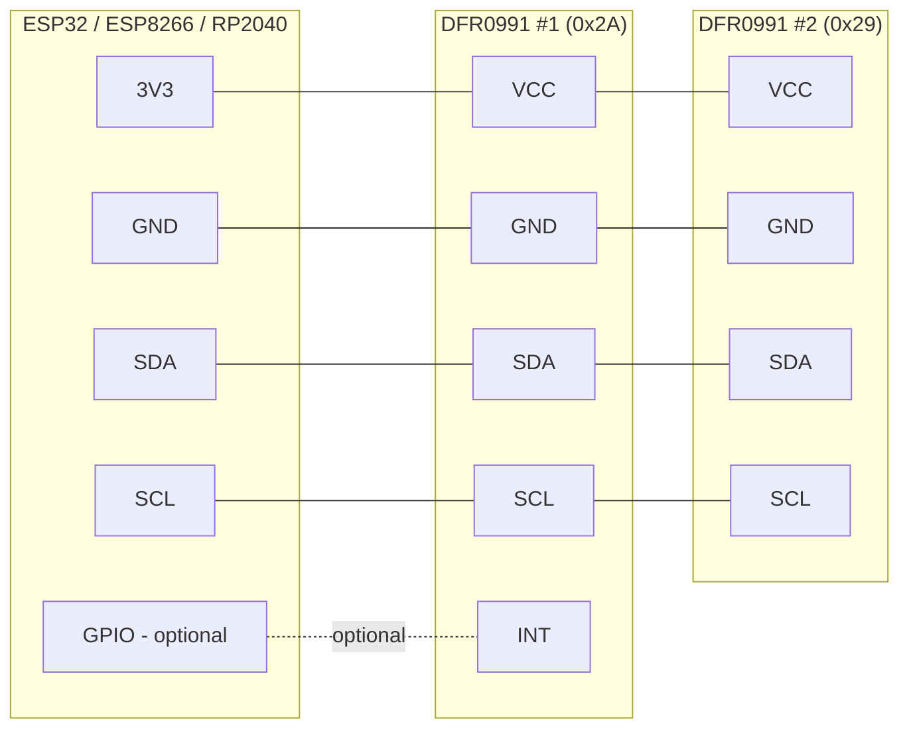

[🇬🇧 English](README.md) | 🇩🇪 Deutsch

# ESPHome DFRobot RGB-LED-Taster (DFR0991)

[](https://github.com/ShadyMCShadesen/esphome-dfrobot-rgb-button/actions/workflows/ci.yaml)
[](https://esphome.io/)
[](LICENSE)

Eine externe [ESPHome](https://esphome.io/)-Komponente für das DFRobot-Modul
**Gravity: I2C RGB LED Button** ([SKU DFR0991](https://wiki.dfrobot.com/dfr0991/)).
Sie spricht das Modul direkt über den ESPHome-I2C-Bus an (ohne Arduino-Bibliothek) und
funktioniert deshalb mit den Frameworks `arduino` und `esp-idf`.

Das Modul selbst ist einfach: drei Farbregister und ein Tasterregister. Alles darüber hinaus
(Klick-Erkennung, Effekte, Statusanzeige, Nachtmodus, ...) setzt diese Komponente in Software
um, und alles davon ist optional.

> [!NOTE]
> Die Komponente wurde anhand des Quellcodes der DFRobot-Bibliothek entwickelt. Getestet ist sie
> durch Kompilieren für alle unterstützten Zielplattformen und durch einen Lauf gegen ein
> **simuliertes** Modul. Auf echter Hardware hat der Autor sie noch nicht bestätigt.
> Rückmeldungen (funktioniert / funktioniert nicht) sind sehr willkommen.

## Inhaltsverzeichnis

- [Funktionen](#funktionen)
- [Kompatibilität](#kompatibilität)
- [Hardware](#hardware)
- [DIP-Schalter-Adressen](#dip-schalter-adressen)
- [Installation](#installation)
- [Schnellstart](#schnellstart)
- [So funktioniert die Tastererkennung](#so-funktioniert-die-tastererkennung)
- [Konfigurationsreferenz](#konfigurationsreferenz)
- [Aktionen, Bedingungen und Trigger](#aktionen-bedingungen-und-trigger)
- [Anwendungsbeispiele](#anwendungsbeispiele)
- [Fehlersuche](#fehlersuche)
- [Bekannte Einschränkungen](#bekannte-einschränkungen)
- [Mitwirken](#mitwirken)
- [Lizenz](#lizenz)

## Funktionen

| | Funktion | Umsetzung |
|---|---|---|
| 💡 | RGB-Licht mit Helligkeit, Übergängen, Effekten, `restore_mode` | Plattform `light` |
| 🔘 | Tasterzustand per Polling (Standard) oder optionalem INT-Pin | Plattform `binary_sensor` |
| 👆 | Einfachklick, Doppelklick, langer Druck (Software) | `on_click`, `on_double_click`, `on_long_press`, `event`, `text_sensor` |
| ✨ | Druck-Feedback und lokaler Umschaltmodus (ohne WLAN) | `press_feedback`, `toggle_mode` |
| 🚦 | Statusanzeige: `idle`, `ok`, `warning`, `error`, `connecting` + eigene | `select`, `dfrobot_rgb_button.set_status`, `connection_status` |
| 🔔 | Blink-Benachrichtigung mit Rückkehr zur vorherigen Anzeige | `dfrobot_rgb_button.flash` |
| 🌙 | Nachtmodus (Helligkeitsgrenze) | `number`, `dfrobot_rgb_button.set_max_brightness` |
| 🔒 | Kindersicherung | `switch`, `dfrobot_rgb_button.lock` / `unlock` |
| ⏲️ | Automatisches Ausschalten der LED | `auto_off` |
| 🎨 | Farb-Presets, Gammakorrektur, Kalibrierung je Kanal | `select`, `gamma_correct`, `color_correct` |
| 🔗 | Gruppen-Sync: mehrere Module zeigen dasselbe | `sync_with` |
| 📊 | Druckzähler (optional persistent), Dauer des letzten Drucks | Plattform `sensor` |
| 🩺 | Watchdog mit automatischer Neuinitialisierung (Hot-Plug), Sensor „Connected“ | eingebaut, `binary_sensor` |
| 🚀 | Boot-Animation | `boot_animation` |

Nichts davon ist aktiv, solange es nicht konfiguriert wird. Eine Konfiguration nur mit
`dfrobot_rgb_button:` und einem `light:`- oder `binary_sensor:`-Eintrag ist gültig.

## Kompatibilität

| Plattform | Framework | Status |
|---|---|---|
| ESP32, ESP32-S2, ESP32-S3, ESP32-C3, ESP32-C6 | `esp-idf`, `arduino` | Unterstützt, wird in der CI kompiliert |
| ESP8266 | `arduino` | Unterstützt, wird in der CI kompiliert |
| RP2040 (Pico W) | `arduino` | Unterstützt, wird in der CI kompiliert |
| nRF52 (Zephyr) | – | Sollte funktionieren (ESPHome bietet dort I2C), nicht getestet |
| LibreTiny (BK72xx, RTL87xx, LN882x) | – | **Nicht möglich**: ESPHomes `i2c`-Komponente gibt es auf LibreTiny nicht (`i2c` ist auf ESP32, ESP8266, RP2040, nRF52 und Host beschränkt) |

**ESPHome-Version:** entwickelt mit 2026.10.2; Mindestversion ist **2026.3.0** (die erste
Version mit der hier verwendeten `synchronous=`-API für die Registrierung von Aktionen). Die CI
baut gegen beide.

## Hardware

Das Modul hat zwei Anschlüsse, die denselben I2C-Bus führen. Welcher genutzt wird, ist egal;
maßgeblich ist die Beschriftung auf der Platine.

**PH2.0-4P-Anschluss (Gravity)**

| Modul-Pin | ESP-Pin | Hinweis |
|---|---|---|
| VCC | 3V3 | Versorgung 3,3–5 V. An 3,3-V-Boards mit 3,3 V betreiben, damit die I2C-Leitungen bei 3,3 V bleiben |
| GND | GND | |
| SCL | I2C SCL, z. B. GPIO22 (ESP32), GPIO5/D1 (ESP8266) | |
| SDA | I2C SDA, z. B. GPIO21 (ESP32), GPIO4/D2 (ESP8266) | |

**2,54-mm-Stiftleiste (5-polig)**

| Modul-Pin | ESP-Pin | Hinweis |
|---|---|---|
| VCC | 3V3 | |
| GND | GND | |
| SCL | I2C SCL | |
| SDA | I2C SDA | |
| INT | beliebiger interruptfähiger GPIO | **Optional.** High, solange der Taster gedrückt ist. Für Polling unbeschaltet lassen |



Bis zu acht Module teilen sich einen Bus, jedes braucht eine eigene Adresse. Weitere Hinweise zur
Verdrahtung stehen in [docs/wiring.md](docs/wiring.md) (englisch).

## DIP-Schalter-Adressen

Die Adresse wird über den dreipoligen DIP-Schalter eingestellt. Laut DFRobot-Bibliothek
**wirkt eine Änderung erst, nachdem das Modul stromlos gemacht und neu gestartet wurde.**

| A2 | A1 | A0 | Adresse |
|:--:|:--:|:--:|:--:|
| 0 | 0 | 0 | `0x23` |
| 0 | 0 | 1 | `0x24` |
| 0 | 1 | 0 | `0x25` |
| 0 | 1 | 1 | `0x26` |
| 1 | 0 | 0 | `0x27` |
| 1 | 0 | 1 | `0x28` |
| 1 | 1 | 0 | `0x29` |
| 1 | 1 | 1 | `0x2A` (Standard der Herstellerbibliothek und dieser Komponente) |

Adressen außerhalb von `0x23`–`0x2A` weist die Komponente schon beim Kompilieren zurück. Wer
unsicher ist, welche Adresse das eigene Modul hat, schaut in den I2C-Scan im Boot-Log (siehe
[Fehlersuche](#fehlersuche)).

## Installation

```yaml
external_components:
  - source: github://ShadyMCShadesen/esphome-dfrobot-rgb-button@main
    components: [dfrobot_rgb_button]
```

Für reproduzierbare Builds einen Release-Tag festlegen und ESPHome cachen lassen:

```yaml
external_components:
  - source: github://ShadyMCShadesen/esphome-dfrobot-rgb-button@v1.0.0
    components: [dfrobot_rgb_button]
    refresh: 1d # wie oft ESPHome das Repository auf Änderungen prüft (Standard: 1d)
```

`refresh: 0s` erzwingt bei jedem Build einen frischen Download – praktisch, solange man `main`
folgt; `refresh: always` bewirkt dasselbe. Mit einem Tag gibt es Updates nur, wenn der Tag
geändert wird.

## Schnellstart

```yaml
i2c:
  sda: GPIO21
  scl: GPIO22
  frequency: 100kHz

dfrobot_rgb_button:
  id: rgb_button
  address: 0x2A

light:
  - platform: dfrobot_rgb_button
    name: "LED"

binary_sensor:
  - platform: dfrobot_rgb_button
    button:
      name: "Button"
```

Vollständige, direkt flashbare Dateien liegen in [`examples/`](examples):

| Datei | Zeigt |
|---|---|
| [`minimal.yaml`](examples/minimal.yaml) | Ein Modul, Licht + Taster, Polling |
| [`multi_button.yaml`](examples/multi_button.yaml) | Drei Module, Gruppen-Sync, ESPHomes `on_multi_click` |
| [`full_featured.yaml`](examples/full_featured.yaml) | Jede Option dieser Komponente |
| [`interrupt_pin.yaml`](examples/interrupt_pin.yaml) | Die optionale Variante mit INT-Pin |

WLAN- und API-Zugangsdaten werden per `!secret` gelesen; dazu
[`examples/secrets.yaml.example`](examples/secrets.yaml.example) nach `secrets.yaml` kopieren und
ausfüllen.

## So funktioniert die Tastererkennung

**Polling (Standard).** Das Tasterregister wird alle `update_interval` gelesen (Standard
`20ms`). Die ESPHome-Hauptschleife läuft etwa alle 16 ms, die effektive Abtastperiode liegt also
bei 16–32 ms. Ein bewusster Tastendruck dauert 50 ms oder länger und wird damit immer mindestens
einmal erfasst, während die Verzögerung unter der Wahrnehmungsschwelle bleibt. Eine Abfrage
besteht aus zwei kurzen I2C-Transaktionen (ca. 0,4 ms bei 100 kHz), also rund 2 % Buslast pro
Modul. Ein kleineres Intervall reagiert schneller, ein größeres (z. B. `50ms`) entlastet den Bus
bei vielen Modulen.

**Interrupt (optional).** Mit `interrupt_pin` setzt die ISR nur ein Flag. Die Hauptschleife liest
dann das Tasterregister per I2C, liest 50 ms lang weiter, bis der Kontakt zur Ruhe gekommen ist,
und fragt ansonsten nur einmal pro Sekunde ab – als Sicherheitsnetz und Verbindungs-Watchdog.

**Entprellung.** Ob die Firmware des Moduls den Kontakt entprellt, ist nicht dokumentiert. Im
Polling-Modus ist die Abtastperiode länger als übliches Kontaktprellen und filtert es dadurch
bereits; `debounce` steht dort deshalb auf `0ms`. Im Interrupt-Modus wird direkt an den Flanken
gelesen, darum ist der Standard `10ms`: Ein neuer Zustand muss so lange stabil sein, bevor er
übernommen wird. ESPHomes `filters:` am Binary Sensor funktionieren zusätzlich.

**Klicks.** Das Modul hat keine Klick-Erkennung; sie erfolgt in Software und arbeitet in beiden
Modi identisch:

- `on_press` / `on_release` lösen sofort aus.
- `on_long_press` löst aus, sobald der Taster `long_press_time` lang gehalten wurde – noch
  während er gedrückt ist.
- `on_click` löst `double_click_time` nach dem Loslassen aus, wenn feststeht, dass kein zweiter
  Klick folgt. Mit `double_click_time: 0ms` wird die Doppelklick-Erkennung abgeschaltet und der
  Klick kommt sofort.
- `on_double_click` löst beim Loslassen des zweiten Klicks aus.

ESPHomes eigene `on_click`, `on_double_click` und `on_multi_click` am Binary Sensor `button`
bleiben voll nutzbar, auch im Polling-Modus.

## Konfigurationsreferenz

### Was die LED anzeigt

Mehrere Funktionen wollen dieselbe LED steuern. Die Komponente setzt sie in festen Ebenen
zusammen; die höchste aktive Ebene gewinnt, und wenn sie endet, scheint die darunterliegende
wieder durch:

1. Boot-Animation
2. Blink-Benachrichtigung (Flash)
3. Druck-Feedback
4. Status (ein gewählter Status außer `idle` oder `connecting`, solange die Verbindung fehlt)
5. Die Licht-Entität (oder mit `sync_with` die Anzeige des anderen Moduls statt der Ebenen 4–5)

Zum Schluss werden Nachtmodus-Grenze und Farbkalibrierung angewendet. Zum Modul wird nur
geschrieben, wenn sich die resultierende Farbe tatsächlich ändert.

### Farben

Überall, wo eine Farbe erwartet wird, sind diese Schreibweisen möglich:

| Form | Beispiel |
|---|---|
| Name (die Farben der Herstellerbibliothek) | `red`, `orange`, `yellow`, `green`, `cyan`, `blue`, `purple`, `white`, `black` |
| Hex-String (Anführungszeichen nötig) | `"#FF8000"` |
| Ganzzahl | `0xFF8000` |
| Mapping | `{red: 100%, green: 50%, blue: 0%}` |

### Hub: `dfrobot_rgb_button`

Ein Eintrag pro Modul. Bei mehreren Modulen eine Liste verwenden und jedem eine `id` geben.

| Option | Typ | Standard | Beschreibung |
|---|---|---|---|
| `id` | ID | generiert | Nötig, um das Modul aus Plattformen und Aktionen anzusprechen |
| `address` | int | `0x2A` | I2C-Adresse, `0x23`–`0x2A` (siehe DIP-Tabelle) |
| `i2c_id` | ID | – | I2C-Bus, falls es mehrere gibt |
| `update_interval` | Zeit | `20ms` | Abfrageintervall des Tasters (1 ms – 1 s). Wird mit `interrupt_pin` ignoriert |
| `interrupt_pin` | Pin | – | Optionaler GPIO am INT-Pin. Aktiviert die interruptgesteuerte Erkennung |
| `debounce` | Zeit | `0ms` Polling, `10ms` Interrupt | Zeit, die ein neuer Tasterzustand stabil sein muss |
| `long_press_time` | Zeit | `800ms` | Haltezeit für einen langen Druck |
| `double_click_time` | Zeit | `300ms` | Maximaler Abstand zwischen zwei Klicks. `0ms` schaltet Doppelklicks ab |
| `press_feedback` | bool / Farbe | aus | Farbe, solange der Taster gehalten wird. `true` bedeutet Weiß |
| `max_brightness` | Prozent | `100%` | Anfängliche Nachtmodus-Grenze für alles, was die LED zeigt |
| `gamma_correct` | float | `2.8` | Gamma für Status-, Flash- und Feedback-Farben sowie für `max_brightness`. `0` schaltet es ab. Die Licht-Entität hat ihr eigenes `gamma_correct` |
| `color_correct` | Liste aus 3 Prozentwerten | `[100%, 100%, 100%]` | Kalibrierung je Kanal (Rot, Grün, Blau), z. B. für den Weißabgleich |
| `statuses` | Liste | eingebaute | Status ergänzen oder eingebaute überschreiben, siehe unten |
| `connection_status` | `none` / `network` / `api` | `none` | Zeigt automatisch den Status `connecting`, solange WLAN/Ethernet (`network`) bzw. die Home-Assistant-API (`api`) nicht verbunden ist |
| `sync_with` | ID | – | Spiegelt die LED eines anderen Moduls. Eigener Flash und eigenes Druck-Feedback wirken weiterhin |
| `boot_animation` | bool | `false` | Spielt beim Start einmal einen 1,5 s langen Regenbogen-Durchlauf |
| `led_refresh_interval` | Zeit | aus | Schreibt die Farbe periodisch neu (min. 100 ms). Hilft, wenn das Modul kurz die Versorgung verlieren kann |
| `locked` | bool | `false` | Startet mit gesperrtem Taster. Gibt es einen `lock`-Switch, entscheidet stattdessen dessen `restore_mode` |
| `on_press`, `on_release`, `on_click`, `on_double_click`, `on_long_press`, `on_locked_press`, `on_connect`, `on_disconnect` | Automation | – | Siehe [Trigger](#trigger) |

**Status.** Eingebaut: `idle` (zeigt das Licht), `ok` (grün), `warning` (orange, blinkt 1 s),
`error` (rot, blinkt 400 ms), `connecting` (blau, atmet 2 s).

| Option | Typ | Standard | Beschreibung |
|---|---|---|---|
| `name` | String | Pflicht | Name im Select und in `set_status`. Ein eingebauter Name überschreibt den jeweiligen Status; `idle` lässt sich nicht umdefinieren |
| `color` | Farbe | Pflicht | |
| `effect` | `solid` / `blink` / `breathe` | `solid` | |
| `period` | Zeit | `1s` | Blink-/Atemperiode (min. 100 ms) |

Die Phasen von Blinken und Atmen leiten sich aus der Laufzeit ab; mehrere Module mit demselben
Status bleiben dadurch im Takt.

### Plattform `light`

Ein RGB-Licht. Alle Optionen eines
[ESPHome-RGB-Lichts](https://esphome.io/components/light/) stehen zur Verfügung (`name`,
`restore_mode`, `default_transition_length`, `gamma_correct`, `effects`, ...).

| Option | Typ | Standard | Beschreibung |
|---|---|---|---|
| `dfrobot_rgb_button_id` | ID | der einzige Hub | Welches Modul |
| `toggle_mode` | bool / Ereignis | `false` | Der Taster schaltet dieses Licht lokal um. `true` = `press`; oder eines von `press`, `release`, `click`, `double_click`, `long_press` |
| `auto_off` | Zeit | aus | Schaltet das Licht so lange nach dem Einschalten wieder aus (min. 1 s) |

**Effekte.** Das Modul hat keine eingebauten Effekte. Diese Komponente bringt zwei
Software-Effekte mit; alle Standard-Effekte von ESPHome (`pulse`, `strobe`, `random`, `flicker`,
`lambda`, ...) funktionieren ebenfalls.

| Effekt | Optionen (Standard) | Beschreibung |
|---|---|---|
| `dfrobot_breathe` | `name` (`Breathe`), `period` (`3s`), `min_brightness` (`10%`), `max_brightness` (`100%`), `update_interval` (`30ms`) | Weiches, sinusförmiges Atmen in der aktuellen Farbe |
| `dfrobot_color_cycle` | `name` (`Color Cycle`), `period` (`18s`), `update_interval` (`50ms`) | Farbdurchlauf nach der Formel des Herstellerbeispiels `breatheLight` |

### Plattform `binary_sensor`

| Option | Typ | Beschreibung |
|---|---|---|
| `dfrobot_rgb_button_id` | ID | Welches Modul |
| `button` | [Binary Sensor](https://esphome.io/components/binary_sensor/) | An, solange der Taster gedrückt ist. Bleibt aus, während die Sperre aktiv ist |
| `connected` | Binary Sensor | Diagnose: an, solange das Modul am Bus antwortet |

### Plattform `sensor`

| Option | Typ | Beschreibung |
|---|---|---|
| `dfrobot_rgb_button_id` | ID | Welches Modul |
| `press_count` | [Sensor](https://esphome.io/components/sensor/) | Anzahl der Tastendrücke. Zusatzoption `restore` (bool, Standard `false`) erhält den Zähler über Neustarts |
| `last_press_duration` | Sensor | Dauer des letzten Drucks in ms |

### Plattform `text_sensor`

| Option | Typ | Beschreibung |
|---|---|---|
| `dfrobot_rgb_button_id` | ID | Welches Modul |
| `last_click` | [Text Sensor](https://esphome.io/components/text_sensor/) | `single`, `double` oder `long` |

### Plattform `event`

| Option | Typ | Beschreibung |
|---|---|---|
| `dfrobot_rgb_button_id` | ID | Welches Modul |
| `click` | [Event](https://esphome.io/components/event/) | Löst `single`, `double`, `long` aus. Der natürliche Weg, Automationen in Home Assistant zu starten |

### Plattform `select`

| Option | Typ | Beschreibung |
|---|---|---|
| `dfrobot_rgb_button_id` | ID | Welches Modul |
| `status` | [Select](https://esphome.io/components/select/) | Wählt den anzuzeigenden Status |
| `preset` | Select | Wendet eine benannte Farbe auf das Licht an (benötigt die Plattform `light`). Zusatzoption `presets`: Liste aus `name` + `color`; Standard sind die acht Herstellerfarben |

### Plattform `switch`

| Option | Typ | Beschreibung |
|---|---|---|
| `dfrobot_rgb_button_id` | ID | Welches Modul |
| `lock` | [Switch](https://esphome.io/components/switch/) | Kindersicherung. Solange an, lösen Tastendrücke keine Ereignisse, kein Umschalten und keine Statistik aus; nur `on_locked_press` feuert. Standard-`restore_mode`: `RESTORE_DEFAULT_OFF` |

### Plattform `number`

| Option | Typ | Beschreibung |
|---|---|---|
| `dfrobot_rgb_button_id` | ID | Welches Modul |
| `max_brightness` | [Number](https://esphome.io/components/number/) | Nachtmodus, 0–100 %. Zusatzoption `restore_value` (bool, Standard `true`) |

## Aktionen, Bedingungen und Trigger

### Aktionen

| Aktion | Parameter | Beschreibung |
|---|---|---|
| `dfrobot_rgb_button.flash` | `id`, `color` *oder* `red`/`green`/`blue` (templatefähig), `count` (3), `duration` (200 ms), `pause` (= `duration`) | Blinken, danach zurück zur vorherigen Anzeige. Nicht blockierend |
| `dfrobot_rgb_button.stop_flash` | `id` | Bricht ein laufendes Blinken ab |
| `dfrobot_rgb_button.set_status` | `id`, `status` (templatefähig), `duration` (optional) | Wählt einen Status. Mit `duration` geht es danach zurück auf `idle` |
| `dfrobot_rgb_button.set_max_brightness` | `id`, `max_brightness` (templatefähig) | Nachtmodus-Grenze |
| `dfrobot_rgb_button.lock` / `.unlock` | `id` | Kindersicherung |
| `dfrobot_rgb_button.reset_press_count` | `id` | Setzt den Druckzähler zurück |

```yaml
on_...:
  - dfrobot_rgb_button.flash:
      id: rgb_button
      color: "#FF8000"
      count: 5
      duration: 150ms
      pause: 100ms
  - dfrobot_rgb_button.set_status:
      id: rgb_button
      status: ok
      duration: 3s
  - dfrobot_rgb_button.set_max_brightness:
      id: rgb_button
      max_brightness: !lambda "return id(sun_is_down) ? 0.15f : 1.0f;"
```

### Bedingungen

`dfrobot_rgb_button.is_pressed`, `dfrobot_rgb_button.is_locked`, `dfrobot_rgb_button.is_connected`

```yaml
- if:
    condition:
      dfrobot_rgb_button.is_locked: rgb_button
    then:
      - logger.log: "locked"
```

### Trigger

| Trigger | Variablen | Löst aus |
|---|---|---|
| `on_press` | – | Wenn der Taster gedrückt wird |
| `on_release` | `duration` (ms, `uint32_t`) | Wenn der Taster losgelassen wird |
| `on_click` | – | Nach einem Einfachklick |
| `on_double_click` | – | Nach einem Doppelklick |
| `on_long_press` | – | Wenn die Haltezeit erreicht ist |
| `on_locked_press` | – | Wenn der Taster bei aktiver Sperre gedrückt wird |
| `on_connect` / `on_disconnect` | – | Wenn das Modul (wieder) erkannt wird / nicht mehr antwortet |

```yaml
dfrobot_rgb_button:
  id: rgb_button
  on_click:
    - homeassistant.event:
        event: esphome.rgb_button
        data:
          action: single
  on_long_press:
    - light.turn_off: button_led
  on_release:
    - logger.log:
        format: "held for %u ms"
        args: ["(unsigned) duration"]
```

## Anwendungsbeispiele

<details>
<summary><b>Statusleuchte</b> – den Zustand von etwas in Home Assistant anzeigen</summary>

```yaml
dfrobot_rgb_button:
  id: rgb_button
  connection_status: api # blaues Atmen, bis Home Assistant verbunden ist
  statuses:
    - name: washing
      color: cyan
      effect: breathe
      period: 4s

select:
  - platform: dfrobot_rgb_button
    status:
      name: "Status" # aus Home Assistant setzen: idle / ok / warning / error / connecting / washing
```

</details>

<details>
<summary><b>Türklingel</b> – funktioniert lokal, meldet an Home Assistant</summary>

```yaml
dfrobot_rgb_button:
  id: rgb_button
  press_feedback: white
  on_press:
    - dfrobot_rgb_button.flash:
        id: rgb_button
        color: green
        count: 3
    - homeassistant.event:
        event: esphome.doorbell

light:
  - platform: dfrobot_rgb_button
    name: "Doorbell LED"
    restore_mode: ALWAYS_ON # gedimmtes Orientierungslicht

number:
  - platform: dfrobot_rgb_button
    max_brightness:
      name: "Doorbell LED Max Brightness"
```

</details>

<details>
<summary><b>Szenenschalter</b> – drei Gesten auf einem Taster</summary>

```yaml
dfrobot_rgb_button:
  id: rgb_button
  press_feedback: true

event:
  - platform: dfrobot_rgb_button
    click:
      name: "Scene Button" # Ereignistypen: single, double, long
```

In Home Assistant eine Automation anlegen, die von der Event-Entität ausgelöst wird, und nach
`event_type` verzweigen.

</details>

<details>
<summary><b>Benachrichtigungstaster</b> – blinken, bis quittiert wird</summary>

```yaml
api:
  actions:
    - action: notify
      then:
        - dfrobot_rgb_button.set_status:
            id: rgb_button
            status: warning

dfrobot_rgb_button:
  id: rgb_button
  on_click:
    # Quittieren: Blinken beenden und mit kurzem grünem Blinken bestätigen.
    - dfrobot_rgb_button.set_status:
        id: rgb_button
        status: idle
    - dfrobot_rgb_button.flash:
        id: rgb_button
        color: green
        count: 1
```

</details>

<details>
<summary><b>Zeitgesteuerter Nachtmodus</b></summary>

```yaml
time:
  - platform: homeassistant
    on_time:
      - seconds: 0
        minutes: 0
        hours: 22
        then:
          - dfrobot_rgb_button.set_max_brightness:
              id: rgb_button
              max_brightness: 15%
      - seconds: 0
        minutes: 0
        hours: 7
        then:
          - dfrobot_rgb_button.set_max_brightness:
              id: rgb_button
              max_brightness: 100%
```

</details>

## Fehlersuche

**1. I2C-Scan prüfen.** ESPHome scannt den Bus beim Start (`i2c: scan: true` ist Standard):

```text
[i2c.idf:102]: Results from bus scan:
[i2c.idf:108]: Found device at address 0x2A
```

Kein Gerät gefunden: VCC/GND, vertauschte SDA/SCL und die Pins unter `i2c:` prüfen. Ein Gerät
an einer anderen Adresse zwischen `0x23` und `0x2A`: `address:` anpassen oder den DIP-Schalter
umstellen und das Modul stromlos machen.

**2. Log der Komponente lesen.** `dump_config` gibt das Erkennungsergebnis und alle
Einstellungen aus:

```text
[dfrobot_rgb_button:xxx]: DFRobot RGB LED Button (DFR0991):
[dfrobot_rgb_button:xxx]:   Address: 0x2A
[dfrobot_rgb_button:xxx]:   Product ID: 0x43DF (OK)
```

**3. Ausführliche Logs einschalten**, um jeden LED-Schreibvorgang und jeden I2C-Fehler zu sehen:

```yaml
logger:
  level: VERY_VERBOSE
  logs:
    # optional: den Rest ruhig halten
    component: ERROR
```

| Symptom | Wahrscheinliche Ursache und Abhilfe |
|---|---|
| `No response from module at 0x2A` | Verdrahtung, Versorgung oder falsche Adresse. Die Komponente versucht es jede Sekunde erneut – die Verdrahtung lässt sich im laufenden Betrieb korrigieren |
| `reports product ID 0x...., expected 0x43DF` | Ein anderes I2C-Gerät belegt diese Adresse |
| `Address 0x.. cannot be set with the DIP switch` | `address:` muss `0x23`–`0x2A` sein |
| Änderung am DIP-Schalter wirkt nicht | Modul stromlos machen und neu starten |
| `on_click` wirkt träge | Es wartet `double_click_time`, um einen Doppelklick auszuschließen. `on_press` verwenden oder `double_click_time: 0ms` setzen |
| Doppelklicks kommen als zwei Einzelklicks an | `double_click_time` erhöhen |
| Tastendrücke gehen verloren | `update_interval` verkleinern; auf Warnungen `Component ... took a long time` achten – andere Komponenten blockieren dann die Schleife |
| Phantom-Doppeldrücke mit `interrupt_pin` | `debounce` erhöhen |
| LED bleibt dunkel, nachdem das Modul kurz ohne Strom war | `led_refresh_interval` setzen, z. B. `30s` |
| Farben stimmen nicht / Weiß hat einen Farbstich | `color_correct` anpassen; `gamma_correct` des Lichts prüfen |
| „Connected“ flattert bei langen Leitungen | Bus-`frequency` senken (z. B. `50kHz`), Leitungen kürzen, Pull-ups ergänzen |
| `Platform not found: light.dfrobot_rgb_button` | Der `external_components`-Eintrag fehlt oder ist gecacht: einmal `refresh: 0s` verwenden |

## Bekannte Einschränkungen

- **Keine Hardware-Effekte, kein Helligkeitsregister, keine Klick-Erkennung im Modul.** Die
  DFRobot-Bibliothek kennt nur RGB-Werte, den Tasterzustand und eine Produkt-ID. Helligkeit,
  Atmen, Klicks usw. werden auf dem ESP berechnet. Animationen stehen deshalb still, solange der
  ESP beschäftigt ist oder neu startet.
- **Noch nicht auf echter Hardware verifiziert** (siehe Hinweis oben). Alles aus der
  Herstellerbibliothek Übernommene und jede Annahme steht in
  [docs/research.md](docs/research.md) (englisch).
- **LibreTiny wird nicht unterstützt**, weil ESPHome dort keine I2C-Komponente hat.
- **I2C-Geschwindigkeit:** Die Herstellerbibliothek nutzt immer 100 kHz. 400 kHz ist ungetestet.
- **Einfachklicks sind um `double_click_time` verzögert** (prinzipbedingt bei
  Doppelklick-Erkennung).
- **Ein Druck, der kürzer als die Abtastperiode ist, kann im Polling-Modus verloren gehen.** Mit
  den Standardwerten heißt das: deutlich unter 32 ms.
- **`sync_with`-Follower hängen einen Schleifendurchlauf (ca. 16 ms) hinterher** und ignorieren
  ihre eigene Licht-Entität und ihren eigenen Status.
- **Der Druckzähler wird über ESPHomes Preferences ins Flash geschrieben**, also höchstens alle
  `flash_write_interval` (Standard 1 min); Tastendrücke kurz vor einem Stromausfall können
  verloren gehen.
- **`auto_off` zählt ab dem Einschalten des Lichts**; ein Farbwechsel startet den Timer nicht neu.
- Das Register `0x00` (I2C-Adresse) ist in der Bibliothek dokumentiert, wird hier aber nicht
  verwendet.

## Mitwirken

Issues und Pull Requests sind willkommen, besonders Testberichte von echter Hardware.

```bash
pip install esphome ruff clang-format
```

```bash
tests/build.sh full_featured esp32-idf config
```

```bash
tests/build.sh full_featured esp8266 compile
```

```bash
esphome compile tests/host/simulation.yaml
```

Der letzte Befehl baut den Verhaltenstest für die Host-Plattform; die entstandene
`program`-Datei ausführen, um ihn gegen das simulierte Modul laufen zu lassen. Vor einem Pull
Request bitte `ruff format components`, `ruff check components` und `clang-format -i` auf
geänderte C++-Dateien anwenden.

## Lizenz

[MIT](LICENSE). Keine Verbindung zu DFRobot. Die Registerdefinitionen stammen aus DFRobots
MIT-lizenzierter Bibliothek [DFRobot_RGBButton](https://github.com/DFRobot/DFRobot_RGBButton).
