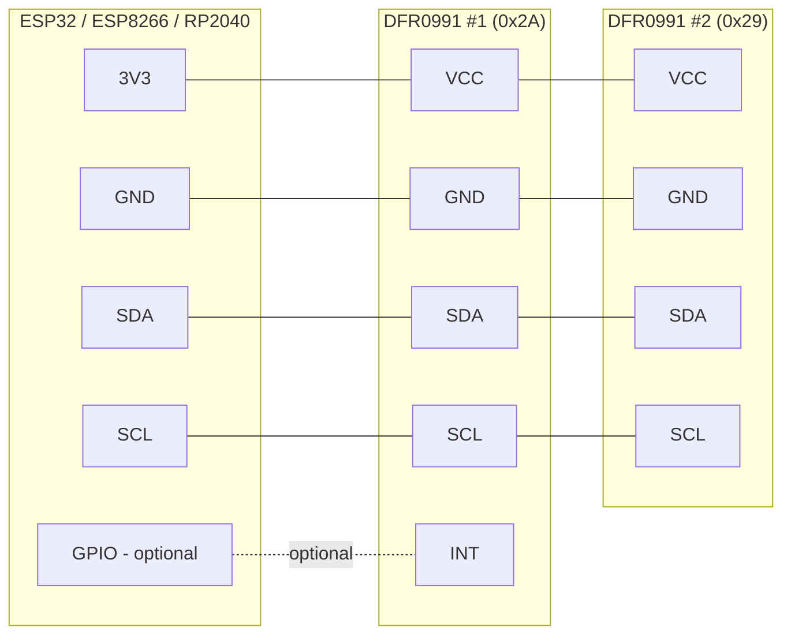

🇬🇧 English | [🇩🇪 Deutsch](README.de.md)

# ESPHome DFRobot RGB LED Button (DFR0991)

[](https://github.com/ShadyMCShadesen/esphome-dfrobot-rgb-button/actions/workflows/ci.yaml)
[](https://esphome.io/)
[](LICENSE)

An [ESPHome](https://esphome.io/) external component for the DFRobot
**Gravity: I2C RGB LED Button Module** ([SKU DFR0991](https://wiki.dfrobot.com/dfr0991/)).
It talks to the module natively over the ESPHome I2C bus (no Arduino library), so it works with
both the `arduino` and the `esp-idf` framework.

The module itself is simple: three colour registers and one button register. Everything beyond
that (click detection, effects, status display, night mode, ...) is implemented in software by
this component and is optional.

> [!NOTE]
> This component was developed from DFRobot's library source code and is tested by compiling for
> all supported targets and by running it against a **simulated** module. It has not yet been
> confirmed on real hardware by the author. Reports (working or not) are very welcome.

## Table of contents

- [Features](#features)
- [Compatibility](#compatibility)
- [Hardware](#hardware)
- [DIP switch addresses](#dip-switch-addresses)
- [Installation](#installation)
- [Quick start](#quick-start)
- [How button detection works](#how-button-detection-works)
- [Configuration reference](#configuration-reference)
- [Actions, conditions and triggers](#actions-conditions-and-triggers)
- [Example use cases](#example-use-cases)
- [Troubleshooting](#troubleshooting)
- [Known limitations](#known-limitations)
- [Contributing](#contributing)
- [License](#license)

## Features

| | Feature | How |
|---|---|---|
| 💡 | RGB light with brightness, transitions, effects, `restore_mode` | `light` platform |
| 🔘 | Button state, by polling (default) or optional INT pin | `binary_sensor` platform |
| 👆 | Single click, double click, long press (software) | `on_click`, `on_double_click`, `on_long_press`, `event`, `text_sensor` |
| ✨ | Press feedback and local toggle mode (work without Wi-Fi) | `press_feedback`, `toggle_mode` |
| 🚦 | Status display: `idle`, `ok`, `warning`, `error`, `connecting` + your own | `select`, `dfrobot_rgb_button.set_status`, `connection_status` |
| 🔔 | Flash notification that returns to the previous display | `dfrobot_rgb_button.flash` |
| 🌙 | Night mode (brightness limit) | `number`, `dfrobot_rgb_button.set_max_brightness` |
| 🔒 | Child lock | `switch`, `dfrobot_rgb_button.lock` / `unlock` |
| ⏲️ | LED auto-off timer | `auto_off` |
| 🎨 | Colour presets, gamma correction, per-channel calibration | `select`, `gamma_correct`, `color_correct` |
| 🔗 | Group sync: several modules show the same thing | `sync_with` |
| 📊 | Press counter (optionally persistent), last press duration | `sensor` platform |
| 🩺 | Watchdog with automatic re-init on hot-plug, "Connected" sensor | built in, `binary_sensor` |
| 🚀 | Boot animation | `boot_animation` |

Everything is off unless you configure it. A configuration with only `dfrobot_rgb_button:` and a
`light:` or `binary_sensor:` entry is valid.

## Compatibility

| Platform | Framework | Status |
|---|---|---|
| ESP32, ESP32-S2, ESP32-S3, ESP32-C3, ESP32-C6 | `esp-idf`, `arduino` | Supported, compiled in CI |
| ESP8266 | `arduino` | Supported, compiled in CI |
| RP2040 (Pico W) | `arduino` | Supported, compiled in CI |
| nRF52 (Zephyr) | – | Should work (ESPHome provides I2C there), not tested |
| LibreTiny (BK72xx, RTL87xx, LN882x) | – | **Not possible**: ESPHome's `i2c` component is not available on LibreTiny (`i2c` is limited to ESP32, ESP8266, RP2040, nRF52 and host) |

**ESPHome version:** developed against 2026.10.2; the minimum is **2026.3.0** (the first release
with the `synchronous=` action registration API this component uses). CI builds against both.

## Hardware

The module has two connectors carrying the same I2C bus. Use whichever is convenient; follow the
labels printed on the board.

**PH2.0-4P (Gravity) connector**

| Module pin | ESP pin | Note |
|---|---|---|
| VCC | 3V3 | 3.3–5 V supply. Use 3.3 V with 3.3 V boards so the I2C lines stay at 3.3 V |
| GND | GND | |
| SCL | I2C SCL, e.g. GPIO22 (ESP32), GPIO5/D1 (ESP8266) | |
| SDA | I2C SDA, e.g. GPIO21 (ESP32), GPIO4/D2 (ESP8266) | |

**2.54 mm 5-pin header**

| Module pin | ESP pin | Note |
|---|---|---|
| VCC | 3V3 | |
| GND | GND | |
| SCL | I2C SCL | |
| SDA | I2C SDA | |
| INT | any interrupt-capable GPIO | **Optional.** High while the button is pressed. Leave unconnected for polling |



Up to eight modules share one bus. Each needs its own address. More wiring notes are in
[docs/wiring.md](docs/wiring.md).

## DIP switch addresses

The address is set with the 3-position DIP switch. According to DFRobot's library, **a changed
setting only takes effect after the module has been power-cycled.**

| A2 | A1 | A0 | Address |
|:--:|:--:|:--:|:--:|
| 0 | 0 | 0 | `0x23` |
| 0 | 0 | 1 | `0x24` |
| 0 | 1 | 0 | `0x25` |
| 0 | 1 | 1 | `0x26` |
| 1 | 0 | 0 | `0x27` |
| 1 | 0 | 1 | `0x28` |
| 1 | 1 | 0 | `0x29` |
| 1 | 1 | 1 | `0x2A` (default of the vendor library and of this component) |

The component rejects any address outside `0x23`–`0x2A` at compile time. If you are unsure which
address your module has, look at the I2C scan in the boot log (see [Troubleshooting](#troubleshooting)).

## Installation

```yaml
external_components:
  - source: github://ShadyMCShadesen/esphome-dfrobot-rgb-button@main
    components: [dfrobot_rgb_button]
```

For reproducible builds, pin a release tag and let ESPHome cache it:

```yaml
external_components:
  - source: github://ShadyMCShadesen/esphome-dfrobot-rgb-button@v1.0.0
    components: [dfrobot_rgb_button]
    refresh: 1d # how often ESPHome checks the repository for updates (default: 1d)
```

`refresh: 0s` forces a fresh download on every build, which is handy while following `main`;
`refresh: always` does the same. With a tag, updates only happen when you change the tag.

## Quick start

```yaml
i2c:
  sda: GPIO21
  scl: GPIO22
  frequency: 100kHz

dfrobot_rgb_button:
  id: rgb_button
  address: 0x2A

light:
  - platform: dfrobot_rgb_button
    name: "LED"

binary_sensor:
  - platform: dfrobot_rgb_button
    button:
      name: "Button"
```

Complete, ready-to-flash files are in [`examples/`](examples):

| File | Shows |
|---|---|
| [`minimal.yaml`](examples/minimal.yaml) | One module, light + button, polling |
| [`multi_button.yaml`](examples/multi_button.yaml) | Three modules, group sync, ESPHome `on_multi_click` |
| [`full_featured.yaml`](examples/full_featured.yaml) | Every option of this component |
| [`interrupt_pin.yaml`](examples/interrupt_pin.yaml) | The optional INT pin variant |

Wi-Fi and API credentials are read with `!secret`; copy
[`examples/secrets.yaml.example`](examples/secrets.yaml.example) to `secrets.yaml` and fill it in.

## How button detection works

**Polling (default).** The button register is read every `update_interval` (default `20ms`).
ESPHome's main loop runs roughly every 16 ms, so the effective sampling period is 16–32 ms. A
deliberate tap lasts 50 ms or more and is therefore always seen at least once, while the delay
stays below what a person notices. One poll is two short I2C transactions (about 0.4 ms at
100 kHz), i.e. roughly 2 % bus load per module. Lower the interval for faster response or raise
it (e.g. `50ms`) to reduce bus traffic with many modules.

**Interrupt (optional).** With `interrupt_pin` set, the ISR only sets a flag. The main loop then
reads the button register over I2C, keeps re-reading for 50 ms to let the contact settle, and
otherwise only polls once per second as a safety net and connection watchdog.

**Debouncing.** Whether the module's firmware debounces the contact is not documented. In
polling mode the sampling period is longer than typical contact bounce, which already filters
it, so `debounce` defaults to `0ms`. In interrupt mode reads happen right at the edges, so the
default is `10ms`: a new state must be stable that long before it is accepted. ESPHome's
`filters:` on the binary sensor work in addition.

**Clicks.** The module has no click detection; it is done in software and works identically in
both modes:

- `on_press` / `on_release` fire immediately.
- `on_long_press` fires as soon as the button has been held for `long_press_time`, while it is
  still down.
- `on_click` fires `double_click_time` after the release, once it is clear that no second click
  follows. Set `double_click_time: 0ms` to disable double-click detection and get instant clicks.
- `on_double_click` fires on the release of the second click.

ESPHome's own `on_click`, `on_double_click` and `on_multi_click` on the `button` binary sensor
remain fully usable, also in polling mode.

## Configuration reference

### What the LED shows

Several features want to control one LED. The component composes them in fixed layers; the
highest active layer wins, and when it ends the layer below shows through again:

1. Boot animation
2. Flash notification
3. Press feedback
4. Status (a selected status other than `idle`, or `connecting` while the connection is down)
5. The light entity (or, with `sync_with`, the other module's display instead of layers 4–5)

Finally the night-mode limit and the colour calibration are applied. The module is only written
to when the resulting colour actually changes.

### Colours

Wherever a colour is expected you can write:

| Form | Example |
|---|---|
| Name (the colours of the vendor library) | `red`, `orange`, `yellow`, `green`, `cyan`, `blue`, `purple`, `white`, `black` |
| Hex string (quotes required) | `"#FF8000"` |
| Integer | `0xFF8000` |
| Mapping | `{red: 100%, green: 50%, blue: 0%}` |

### Hub: `dfrobot_rgb_button`

One entry per module. With several modules use a list and give each an `id`.

| Option | Type | Default | Description |
|---|---|---|---|
| `id` | ID | generated | Needed to reference the module from platforms and actions |
| `address` | int | `0x2A` | I2C address, `0x23`–`0x2A` (see DIP switch table) |
| `i2c_id` | ID | – | I2C bus, if you have more than one |
| `update_interval` | time | `20ms` | Polling interval for the button (1 ms – 1 s). Ignored with `interrupt_pin` |
| `interrupt_pin` | pin | – | Optional GPIO connected to INT. Enables interrupt-driven detection |
| `debounce` | time | `0ms` polling, `10ms` interrupt | Time a new button state must be stable |
| `long_press_time` | time | `800ms` | Hold time for a long press |
| `double_click_time` | time | `300ms` | Maximum gap between two clicks. `0ms` disables double clicks |
| `press_feedback` | bool / colour | off | Colour shown while the button is held. `true` means white |
| `max_brightness` | percentage | `100%` | Initial night-mode limit for everything the LED shows |
| `gamma_correct` | float | `2.8` | Gamma for status, flash and feedback colours and for `max_brightness`. `0` disables it. The light entity has its own `gamma_correct` |
| `color_correct` | list of 3 percentages | `[100%, 100%, 100%]` | Per-channel calibration (red, green, blue), e.g. for white balance |
| `statuses` | list | built-ins | Add statuses or override built-in ones, see below |
| `connection_status` | `none` / `network` / `api` | `none` | Show the `connecting` status automatically while Wi-Fi/Ethernet (`network`) or the Home Assistant API (`api`) is not connected |
| `sync_with` | ID | – | Mirror the LED of another module. Own flash and press feedback still apply |
| `boot_animation` | bool | `false` | Play a 1.5 s rainbow sweep once at start-up |
| `led_refresh_interval` | time | off | Rewrite the colour periodically (min. 100 ms). Helps if the module can lose power briefly |
| `locked` | bool | `false` | Start with the button locked. If a `lock` switch exists, its `restore_mode` decides instead |
| `on_press`, `on_release`, `on_click`, `on_double_click`, `on_long_press`, `on_locked_press`, `on_connect`, `on_disconnect` | automation | – | See [Triggers](#triggers) |

**Statuses.** Built in: `idle` (shows the light), `ok` (green), `warning` (orange, blinking 1 s),
`error` (red, blinking 400 ms), `connecting` (blue, breathing 2 s).

| Option | Type | Default | Description |
|---|---|---|---|
| `name` | string | required | Name used in the select and in `set_status`. Re-using a built-in name overrides it; `idle` cannot be redefined |
| `color` | colour | required | |
| `effect` | `solid` / `blink` / `breathe` | `solid` | |
| `period` | time | `1s` | Blink / breathe period (min. 100 ms) |

Blink and breathe phases are derived from the uptime, so several modules showing the same status
stay in step.

### `light` platform

An RGB light. All options of an
[ESPHome RGB light](https://esphome.io/components/light/) are available (`name`, `restore_mode`,
`default_transition_length`, `gamma_correct`, `effects`, ...).

| Option | Type | Default | Description |
|---|---|---|---|
| `dfrobot_rgb_button_id` | ID | the only hub | Which module |
| `toggle_mode` | bool / event | `false` | Let the button toggle this light locally. `true` = `press`; or one of `press`, `release`, `click`, `double_click`, `long_press` |
| `auto_off` | time | off | Turn the light off this long after it was turned on (min. 1 s) |

**Effects.** The module has no built-in effects. This component adds two software effects; all
standard ESPHome effects (`pulse`, `strobe`, `random`, `flicker`, `lambda`, ...) work too.

| Effect | Options (default) | Description |
|---|---|---|
| `dfrobot_breathe` | `name` (`Breathe`), `period` (`3s`), `min_brightness` (`10%`), `max_brightness` (`100%`), `update_interval` (`30ms`) | Smooth sine-shaped breathing in the current colour |
| `dfrobot_color_cycle` | `name` (`Color Cycle`), `period` (`18s`), `update_interval` (`50ms`) | Colour cycle using the formula of the vendor's `breatheLight` example |

### `binary_sensor` platform

| Option | Type | Description |
|---|---|---|
| `dfrobot_rgb_button_id` | ID | Which module |
| `button` | [binary sensor](https://esphome.io/components/binary_sensor/) | On while the button is pressed. Stays off while the lock is active |
| `connected` | binary sensor | Diagnostic: on while the module answers on the bus |

### `sensor` platform

| Option | Type | Description |
|---|---|---|
| `dfrobot_rgb_button_id` | ID | Which module |
| `press_count` | [sensor](https://esphome.io/components/sensor/) | Number of presses. Extra option `restore` (bool, default `false`) keeps the count across reboots |
| `last_press_duration` | sensor | Duration of the last press in ms |

### `text_sensor` platform

| Option | Type | Description |
|---|---|---|
| `dfrobot_rgb_button_id` | ID | Which module |
| `last_click` | [text sensor](https://esphome.io/components/text_sensor/) | `single`, `double` or `long` |

### `event` platform

| Option | Type | Description |
|---|---|---|
| `dfrobot_rgb_button_id` | ID | Which module |
| `click` | [event](https://esphome.io/components/event/) | Fires `single`, `double`, `long`. The natural way to trigger Home Assistant automations |

### `select` platform

| Option | Type | Description |
|---|---|---|
| `dfrobot_rgb_button_id` | ID | Which module |
| `status` | [select](https://esphome.io/components/select/) | Choose the status to display |
| `preset` | select | Apply a named colour to the light (requires the `light` platform). Extra option `presets`: list of `name` + `color`; defaults to the eight vendor colours |

### `switch` platform

| Option | Type | Description |
|---|---|---|
| `dfrobot_rgb_button_id` | ID | Which module |
| `lock` | [switch](https://esphome.io/components/switch/) | Child lock. While on, presses cause no events, no toggle and no statistics; only `on_locked_press` fires. Default `restore_mode`: `RESTORE_DEFAULT_OFF` |

### `number` platform

| Option | Type | Description |
|---|---|---|
| `dfrobot_rgb_button_id` | ID | Which module |
| `max_brightness` | [number](https://esphome.io/components/number/) | Night mode, 0–100 %. Extra option `restore_value` (bool, default `true`) |

## Actions, conditions and triggers

### Actions

| Action | Parameters | Description |
|---|---|---|
| `dfrobot_rgb_button.flash` | `id`, `color` *or* `red`/`green`/`blue` (templatable), `count` (3), `duration` (200 ms), `pause` (= `duration`) | Flash, then return to the previous display. Non-blocking |
| `dfrobot_rgb_button.stop_flash` | `id` | Abort a running flash |
| `dfrobot_rgb_button.set_status` | `id`, `status` (templatable), `duration` (optional) | Select a status. With `duration` it returns to `idle` afterwards |
| `dfrobot_rgb_button.set_max_brightness` | `id`, `max_brightness` (templatable) | Night mode limit |
| `dfrobot_rgb_button.lock` / `.unlock` | `id` | Child lock |
| `dfrobot_rgb_button.reset_press_count` | `id` | Reset the press counter |

```yaml
on_...:
  - dfrobot_rgb_button.flash:
      id: rgb_button
      color: "#FF8000"
      count: 5
      duration: 150ms
      pause: 100ms
  - dfrobot_rgb_button.set_status:
      id: rgb_button
      status: ok
      duration: 3s
  - dfrobot_rgb_button.set_max_brightness:
      id: rgb_button
      max_brightness: !lambda "return id(sun_is_down) ? 0.15f : 1.0f;"
```

### Conditions

`dfrobot_rgb_button.is_pressed`, `dfrobot_rgb_button.is_locked`, `dfrobot_rgb_button.is_connected`

```yaml
- if:
    condition:
      dfrobot_rgb_button.is_locked: rgb_button
    then:
      - logger.log: "locked"
```

### Triggers

| Trigger | Variables | Fires |
|---|---|---|
| `on_press` | – | When the button goes down |
| `on_release` | `duration` (ms, `uint32_t`) | When the button comes up |
| `on_click` | – | After a single click |
| `on_double_click` | – | After a double click |
| `on_long_press` | – | When the hold time is reached |
| `on_locked_press` | – | When the button is pressed while locked |
| `on_connect` / `on_disconnect` | – | When the module is (re)detected / stops answering |

```yaml
dfrobot_rgb_button:
  id: rgb_button
  on_click:
    - homeassistant.event:
        event: esphome.rgb_button
        data:
          action: single
  on_long_press:
    - light.turn_off: button_led
  on_release:
    - logger.log:
        format: "held for %u ms"
        args: ["(unsigned) duration"]
```

## Example use cases

<details>
<summary><b>Status light</b> – show the state of something in Home Assistant</summary>

```yaml
dfrobot_rgb_button:
  id: rgb_button
  connection_status: api # blue breathing until Home Assistant is connected
  statuses:
    - name: washing
      color: cyan
      effect: breathe
      period: 4s

select:
  - platform: dfrobot_rgb_button
    status:
      name: "Status" # set from Home Assistant: idle / ok / warning / error / connecting / washing
```

</details>

<details>
<summary><b>Doorbell</b> – works locally, notifies Home Assistant</summary>

```yaml
dfrobot_rgb_button:
  id: rgb_button
  press_feedback: white
  on_press:
    - dfrobot_rgb_button.flash:
        id: rgb_button
        color: green
        count: 3
    - homeassistant.event:
        event: esphome.doorbell

light:
  - platform: dfrobot_rgb_button
    name: "Doorbell LED"
    restore_mode: ALWAYS_ON # dim orientation light

number:
  - platform: dfrobot_rgb_button
    max_brightness:
      name: "Doorbell LED Max Brightness"
```

</details>

<details>
<summary><b>Scene switch</b> – three gestures on one button</summary>

```yaml
dfrobot_rgb_button:
  id: rgb_button
  press_feedback: true

event:
  - platform: dfrobot_rgb_button
    click:
      name: "Scene Button" # event types: single, double, long
```

In Home Assistant, create an automation triggered by the event entity and branch on
`event_type`.

</details>

<details>
<summary><b>Notification button</b> – flash until acknowledged</summary>

```yaml
api:
  actions:
    - action: notify
      then:
        - dfrobot_rgb_button.set_status:
            id: rgb_button
            status: warning

dfrobot_rgb_button:
  id: rgb_button
  on_click:
    # Acknowledge: stop blinking and confirm with a short green flash.
    - dfrobot_rgb_button.set_status:
        id: rgb_button
        status: idle
    - dfrobot_rgb_button.flash:
        id: rgb_button
        color: green
        count: 1
```

</details>

<details>
<summary><b>Night mode by time</b></summary>

```yaml
time:
  - platform: homeassistant
    on_time:
      - seconds: 0
        minutes: 0
        hours: 22
        then:
          - dfrobot_rgb_button.set_max_brightness:
              id: rgb_button
              max_brightness: 15%
      - seconds: 0
        minutes: 0
        hours: 7
        then:
          - dfrobot_rgb_button.set_max_brightness:
              id: rgb_button
              max_brightness: 100%
```

</details>

## Troubleshooting

**1. Check the I2C scan.** ESPHome scans the bus at boot (`i2c: scan: true` is the default):

```text
[i2c.idf:102]: Results from bus scan:
[i2c.idf:108]: Found device at address 0x2A
```

No device found: check VCC/GND, swapped SDA/SCL, and the pins in `i2c:`. A device at another
address between `0x23` and `0x2A`: set `address:` accordingly, or change the DIP switch and
power-cycle the module.

**2. Read the component's log.** `dump_config` prints the detection result and all settings:

```text
[dfrobot_rgb_button:xxx]: DFRobot RGB LED Button (DFR0991):
[dfrobot_rgb_button:xxx]:   Address: 0x2A
[dfrobot_rgb_button:xxx]:   Product ID: 0x43DF (OK)
```

**3. Enable verbose logs** to see every LED write and I2C error:

```yaml
logger:
  level: VERY_VERBOSE
  logs:
    # optional: keep the rest quiet
    component: ERROR
```

| Symptom | Likely cause and fix |
|---|---|
| `No response from module at 0x2A` | Wiring, power or wrong address. The component keeps retrying every second, so you can fix the wiring while it runs |
| `reports product ID 0x...., expected 0x43DF` | A different I2C device uses this address |
| `Address 0x.. cannot be set with the DIP switch` | `address:` must be `0x23`–`0x2A` |
| DIP switch change has no effect | Power-cycle the module |
| `on_click` feels slow | It waits `double_click_time` to rule out a double click. Use `on_press`, or set `double_click_time: 0ms` |
| Double clicks are reported as two single clicks | Increase `double_click_time` |
| Presses are missed | Lower `update_interval`; check for `Component ... took a long time` warnings from other components blocking the loop |
| Phantom double presses with `interrupt_pin` | Increase `debounce` |
| LED stays dark after the module lost power briefly | Set `led_refresh_interval`, e.g. `30s` |
| Colours look wrong / white is tinted | Adjust `color_correct`; check the light's `gamma_correct` |
| Module "Connected" flaps with long cables | Lower the bus `frequency` (e.g. `50kHz`), shorten cables, add pull-ups |
| `Platform not found: light.dfrobot_rgb_button` | The `external_components` entry is missing or cached: use `refresh: 0s` once |

## Known limitations

- **No hardware effects, brightness register or click detection.** DFRobot's library exposes
  only RGB values, the button state and a product ID. Brightness, breathing, clicks etc. are
  computed on the ESP. Animations therefore stop while the ESP is busy or rebooting.
- **Not yet verified on real hardware** (see the note at the top). Everything taken from the
  vendor library and every assumption is listed in [docs/research.md](docs/research.md).
- **LibreTiny is not supported** because ESPHome has no I2C component for it.
- **I2C speed:** the vendor library always uses 100 kHz. 400 kHz is untested.
- **Single clicks are delayed** by `double_click_time` (inherent to double-click detection).
- **A press shorter than the polling period can be missed** in polling mode. With the default
  settings that means well under 32 ms.
- **`sync_with` followers lag by one main-loop cycle** (about 16 ms) and ignore their own light
  entity and status.
- **The press counter is written to flash by ESPHome's preference system**, i.e. at most every
  `flash_write_interval` (default 1 min); presses right before a power loss can be lost.
- **`auto_off` counts from the moment the light is turned on**; changing the colour does not
  restart the timer.
- The module's register `0x00` (I2C address) is documented in the library but not used here.

## Contributing

Issues and pull requests are welcome, especially hardware test reports.

```bash
pip install esphome ruff clang-format
```

```bash
tests/build.sh full_featured esp32-idf config
```

```bash
tests/build.sh full_featured esp8266 compile
```

```bash
esphome compile tests/host/simulation.yaml
```

The last command builds the behaviour test for the host platform; run the resulting `program`
binary to execute it against the simulated module. Please run `ruff format components`,
`ruff check components` and `clang-format -i` on changed C++ files before opening a pull request.

## License

[MIT](LICENSE). Not affiliated with DFRobot. Register definitions were derived from DFRobot's
MIT-licensed [DFRobot_RGBButton](https://github.com/DFRobot/DFRobot_RGBButton) library.
